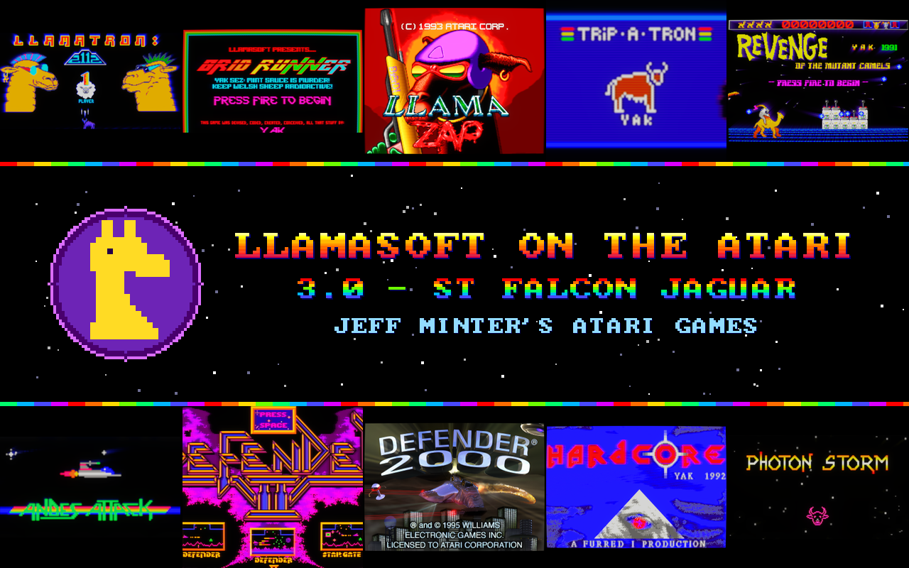

# Llamasoft on the Atari 3.0



**Jeff Minter's Atari ST, Falcon and Jaguar games, remastered for modern screens and pads, with the original
game code running untouched underneath.**

(Until 3.0 this was *Llamasoft on the ST*. Then a Falcon game and a Jaguar cartridge moved in.)

New in 3.0:

- **Llamazap** (Atari Falcon030, 1993): Minter's Falcon shooter, 25 stages over five levels. Playing it
  properly used to mean a Falcon with an Atari Jaguar pad plugged in, because its power-ups are bought on the
  Jaguar pad's number keypad. Here it's complete on any pad, remastered like the ST games.
- **Defender 2000** (Atari Jaguar, 1996): Llamasoft's Jaguar remake of Defender (Classic, Plus and 2000 modes),
  with its own native renderer: smooth motion, wide screen and high-resolution art.
- **Savestates in every game**, real disk labels on the carousel, and a tidier settings panel.

Ten games from Llamasoft's Atari years. From the ST:

- **Llamatron: 2112**
- **Super Gridrunner**
- **Trip-A-Tron**, the light synthesiser
- **Revenge of the Mutant Camels**: the 1 MB STE version and the TT Megamix
- **Andes Attack**
- **Defender 2**: Defender, Defender II and Stargate
- **Photon Storm**
- **Hardcore**, Yak's unfinished evaluation demo

From the Falcon030 and the Jaguar:

- **Llamazap** (Falcon030)
- **Defender 2000** (Jaguar cartridge)

Top features:

- **An interpolated, unlocked frame rate:** sprites drawn at four times the ST's resolution and moving at
  your monitor's full refresh rate.
- **CRT+ and CRT++:** an accurate, beautiful CRT, or a Llamasoft-inspired psychedelic facelift.
- **Pad controls tuned by hand for every game:** each one designed and play-tested by a human for how these
  games feel on a modern controller.
- **Trip-A-Tron, fully working:** with a custom music-reactive module that plays along with whatever your
  PC is playing.
- **Per-game settings** a settings panel accessed with the Back button, enabling graphical tweaks on the fly and per-game control remapping.

All of it responds to the pad quicker than the games did on a real ST thanks to emulation run-ahead.

A hobby project, not affiliated with Jeff Minter or Llamasoft.

## The game is the original: the remaster sits on top

This isn't a remake, a rewrite or a reimplementation from memory. Each game is the original 68000 program,
byte for byte, running in a small Atari ST built into the app (for Llamazap, a small Falcon030; Defender 2000 runs
on an emulated Jaguar). Every wave, enemy pattern, sound and score is the game's own, computed the way it was in
1991.

The remaster sits on top of that and doesn't touch it. The app follows the game as it draws: each time it puts
a sprite on the screen, the remaster notes what it is and where it goes. Then it redraws those objects itself,
at 4x the resolution, interpolating them between the game's own positions. The game never knows: its memory,
its timing and its decisions are exactly what they'd be without the remaster.

Claude checked game by game:

- **Same picture:** with the remaster on, its picture composed at the ST's own resolution matches the
  original's pixel for pixel, over minutes of scripted play on every game.
- **Same game:** the game's memory with the remaster and run-ahead on is identical to a run without them.

Where we change something on purpose, it's listed below with the setting that turns it off.

## What's new in 3.0

### Llamazap, on any pad

Llamazap is Minter's 1993 shooter for the Atari Falcon030: 25 stages over five levels, each stage a different
style of shoot-'em-up, with Llamatron and Gridrunner turning up along the way. It was written for a Falcon with a Jaguar pad
plugged into its enhanced joystick port, and the pad's twelve-key number keypad is how you buy power-ups
mid-fight. That's what made it so awkward to play anywhere else. Here:

- **The app emulates a Falcon030 for it:** a 68030 at 16 MHz, 4 MB of memory, the VIDEL's 256-colour
  overscan modes, the blitter, and the Jaguar pad on the enhanced port. The game's DSP sound program is
  stood in for by our own mixer: its MOD music and effects, **in stereo**.
- **The keypad is gone, not lost:** hold **LB** and the game stops while a menu shows every power-up on
  offer, with the game's own icons, names and costs. Point the right stick at one and let go to buy it. Ships
  are picked with X, A and B, and R3 changes ship mid-game.
- **Twin stick on the Llamatron stages:** the right stick aims the three-way spread.
- **50 frames a second on every screen** (the original drew 25), with the **remaster and run-ahead**: an
  interpolated, unlocked frame rate, as for the ST games.
- **Its manual is included** (typed from the original's pages), and its manual-word protection check is
  answered for you.
- **START AT STAGE** in Settings lets you jump to any of the 25 stages. STOCK FALCON puts it back exactly as
  it was.
- Rumble, remapping, savestates and its own tuned CRT++ look, like the rest.

### Defender 2000, from the Jaguar

Llamasoft's 1996 Jaguar remake of Defender: Classic, Plus and Defender 2000 itself. It isn't an ST game, so it
runs as a program of its own (`d2k.exe`, on the Virtual Jaguar core) and the start screen launches it from a
Jaguar cartridge on the carousel. A native renderer draws the game's own objects:

- **Smooth motion:** the game updates 30 times a second; here everything moves at your display's rate.
- **Wide screen:** the game's world carries on past the 4:3 edges.
- **High-resolution art:** the cartridge's pictures, upscaled four times.
- CRT+ / CRT++, savestates, arcade thrust and reverse buttons, and its own settings menu on Back.

### Savestates, labels and a tidier panel

- **Savestates in every game:** four slots per game, kept on disk, from Settings or F2 / F4.
- **Real labels:** disks now wear scans of their real labels where they exist, and hand-drawn art where
  they don't.
- **The settings panel** puts savestates and the game's own settings first. B now only closes the panel; X
  leaves the game.

## The remaster

### CRT+ and CRT++

**CRT+** is an accurate, beautiful CRT, built for these games rather than borrowed:

- a soft electron beam, with scanlines that swell on bright colours just as a real tube's do
- an aperture-grille phosphor mask with colour bleed
- halation, the glow light makes as it scatters in the glass, computed from the picture in linear light,
  not painted on as a halo
- true blacks, and colour that blooms towards white at its brightest

The picture keeps its true size, in the shape it had on a UK TV in 1991.

**CRT++** is the Llamasoft-inspired facelift. It takes the feedback trails of Minter's light synths and later
games and puts them behind the action: bright things leave tinted trails that zoom, swirl and colour-cycle as
they fade. It adds a composite TV's colour bleed and a boosted glow. It's lurid, joyful, and on by default.

Each game ships with its own look, tuned by hand: the trail colour, length, zoom and glow suit that game. Every
setting can be tuned further in the settings panel, live, with the game paused behind it.

Both looks are also included as shader presets for **ShaderGlass and RetroArch** (`Extras\CRT shaders`, MIT
licence), so you can use them on everything else you play.

### An interpolated, unlocked frame rate

On a real ST these games updated the screen 13-25 times a second, and the busy waves stuttered. Here the
emulated processor gets more power during play, so every game draws all 50 of its frames a second. The game
logic still runs at exactly its original speed, because it was always timed by the 50 Hz display, not by how
fast the processor could draw.

The remaster then unlocks the frame rate entirely:

- Moving objects are drawn at **four times the ST's resolution**.
- They're **interpolated between the game's frames** at your monitor's refresh rate: 60, 120, 144, 240 Hz
  or more. Each object's position is worked out from a continuous clock for the exact moment a frame goes
  out, so the only limit is your display.
- On a variable refresh (G-Sync / FreeSync) screen every frame lands evenly.

It covers play, and also:

- title screens and attract demos
- the instruction scroller
- Photon Storm's bonus tunnel and warp
- Llamatron's wave-change zoom, which builds at the display's rate
- Camels' warp between oases
- Defender 2's end-of-wave screens
- Llamatron's high score entry, where the cursor glides between letters

Trip-A-Tron is the exception: it's a light synthesiser that paints straight into the screen, with no
sprites to interpolate, so it runs as it always did.

Some objects get more than interpolation:

- **Photon Storm's ship turns at its exact angle.** The ST could only show 16 pre-drawn steps.
- **Llamatron's analog shots fly at their true positions** rather than jumping a pixel at a time.

### Quicker than the real thing: run-ahead

Interpolating between frames normally costs a frame of delay. Run-ahead more than wins it back: every frame, a
copy of the machine runs one or two frames ahead with your controls, and you see that future. Measured on
Photon Storm with the default setting, the picture responds about **40 ms sooner than the original game did**
on its own hardware.

### Pad controls, tuned by hand for every game

These games were made for an ST joystick, a mouse and a keyboard. Each one has been given controls designed
for it, then play-tested on a real pad and the Steam Deck, and tuned until it felt right: dead zones,
response curves, how the thrust builds, which button does what. None of them is a generic joystick mapping.

- **Llamatron** is played the way it was meant, "Robotron style": left stick moves, right stick fires. Analog
  aim in any direction is an option. TEAM mode works with a second pad.
- **Photon Storm** becomes a true twin-stick shooter: steer and fly with the left stick, fire in any
  direction with the right. The original's smart bomb, boost and single-shot keys are on the triggers and
  shoulders.
- **Andes Attack and Defender 2** get arcade Defender controls: stick up and down, a reverse button, and
  analog thrust on the right trigger, where the squeeze sets your speed. Andes Attack's thrust builds frame
  for frame like the original's mouse button.
- **Super Gridrunner**, a mouse game, is steered with the stick, with a light inertia so the ship feels
  planted, and the nosecone on the shoulders.
- **The Mutant Camels** spit wherever the right stick points, in all 360 degrees.
- **Hardcore**'s guns follow the sticks.
- **Menus and high score names** all work from the pad, in every game.

Around all of that:

- **Remapping:** every button can be remapped per game in Settings.
- **Button names:** controls are shown as your pad names them (Xbox, PlayStation or Switch), with
  PlayStation's symbols drawn in.
- **Rumble:** read from the game itself: a lost life, a smart bomb, every kill, the Camels' pickups and
  Hardcore's puck.

### Trip-A-Tron, fully working, with a music-reactive module

Minter's 1988 light synthesiser runs complete:

- **It installs itself** on first use.
- **Its tool screens work:** the Sillyscope, Colour Cooker, sequencers, starfield editor and the rest, with
  their text labels drawn as GEM drew them.
- **Its KML programs run:** they're the scripts behind every effect.
- **Its manual is included:** in full, as text and PDF.

On a pad it becomes an instrument:

- the right trigger paints with pressure: a light squeeze for sparse pulses, a hard one for a flood
- effect and symmetry wheels on the shoulders, every key labelled with what it does in the loaded program
- a starfield you fly with the right stick
- gyro aiming on pads that have it

The **music module** is ours, after Minter's later "virtual light machines": it listens to whatever your PC is
playing and performs along with it.

- The light source dances to the bass and mids.
- Beats paint.
- Every few bars the palette and effect move on, and strong beats switch the symmetry.

Your own input always wins, so it's a duet, not a screensaver.

Trip-A-Tron's harshest flashing palettes are calmed into gentle pulses.

### Kinder on eyes and ears

- **Flashes:** the full-screen white flashes and red strobes are removed. Some of them could be a real risk
  for photosensitive players. Trip-A-Tron's aggressive palettes pulse gently instead, and Hardcore starts
  with its strobes off. Gameplay is untouched.
- **Volume:** every game is brought to the same broadcast loudness (EBU R128), with a master volume, so
  switching games doesn't blast you.

### A proper home for them

- **The start screen:** the disks sit on a carousel with hand-written labels. The game you're pointing at
  plays live behind it.
- **How-to-play and docs:** each game has a how-to-play page and its own docs:
  - Yak's notes from the disks
  - Gridrunner's GAME SECRETS pages
  - the full Trip-A-Tron manual (text and PDF)
  - Photon Storm's manual
- **Settings:** one panel, reachable from any game, with the game paused behind it so you see what each
  change does.
- **Steam:** the program can add itself to your Steam library with its own art, and it plays on the Steam
  Deck.
- **Your own disks:** drop any other ST disk image into `game\` and it gets a disk of its own on the carousel.

## Respecting the originals: everything we changed, and how to undo it

| Change | Why | The original |
|---|---|---|
| All the speed-ups (CPU, frame rate, remaster) | - | Settings, the game's section: STOCK ST (your controls stay) |
| 50 frames a second in play | the ST couldn't keep up; the game's speed is unchanged | `--cpu=1`, or per game `grid_50fps=0`, `d2_50fps=0`, `photonstorm_50fps=0` |
| The remaster (4x, interpolated unlocked frame rate) | modern displays | F8 / Settings: the ST's own picture |
| Run-ahead | lower latency than the original | F7 / Settings: 0 |
| CRT+ / CRT++ | the look | F9 / Settings: off |
| Screen flashes removed or calmed | photosensitivity | `--flashes`, `trip_calm_background=0`, `hc_strobes=1`; Llamatron's kill flash alone: Settings, KILL FLASH (white, or a softer blue) |
| Photon Storm at any angle | twin-stick play | Y on its title: the original 16 directions |
| Llamatron analog aim | twin-stick play | off by default (RB on its title) |
| Andes Attack / Defender 2 arcade controls | pads have no mouse | Settings: CONTROL SCHEME; mouse and keyboard work as on the ST |
| Gridrunner: snakes shown 1.5 s before they drop | in the original they lurk half-hidden under the top rail, where shots can't reach, then drop with little warning | `--entry-lane` |
| Gridrunner: the level select unlocks the level you died on | the original unlocked the one before | `grid_unlock_level_died=0` |
| Defender 2 in its 60 Hz mode | the game's own option, as the arcade ran | `defender2_60hz=0` |
| Llamazap at 50 frames a second, remaster, run-ahead | as the ST games | Settings, LLAMAZAP: STOCK FALCON (the 68030's own 16 MHz, 25 a second) |
| Llamazap: the manual's word check answered | the code book isn't to hand | (a skip, not a choice) |
| Llamazap: power-ups bought from a menu (LB) | pads have no keypad | the keyboard's digits are still the keypad |
| Photon Storm: no crash in the warp | the original divides by zero about one warp in ten and crashes the ST | (a fix, not a choice) |
| The cracked releases' prompts and nag screens | these are the copies distributed today | their trainers are offered as options |

Nothing else changes: the enemies, waves, scoring, difficulty, sound and music are the originals'.

## Playing

Download the zip from [Releases](../../releases), unpack it anywhere and run `llamatron.exe`. Nothing to
install. The included `README.txt` has every game's controls and the settings. Settings and high scores are
kept in `userdata\` next to the exe.

The ST games come from the disks Jeff Minter distributes on his own site. Llamatron, Trip-A-Tron and Revenge were
shareware: "please spread this game everywhere". Some came on crack compilation disks; only the Llamasoft
games' own files are kept. Llamazap and Defender 2000 are long out of sale and are included as historic
artefacts.

## How it works

The app is a high-level Atari ST (and, for Llamazap, Falcon030): the 68000 runs on the [Musashi](https://github.com/kstenerud/Musashi)
interpreter, and the shifter, YM2149 sound chip, MFP timers, keyboard processor, STE DMA sound and enough of
TOS and GEM are emulated in C++. Defender 2000 runs on a patched [Virtual
Jaguar](https://github.com/libretro/virtualjaguar-libretro) core with our own renderer on top. The disks are read straight from .msa, .st and Pasti .stx images. SDL 3
handles video, sound and pads.

The remaster hooks each game's own drawing routines: sprite blitters, dot plotters, line and terrain drawers.
Each sprite's image is decoded once, by running the game's own routine on a scratch copy of the machine, then
cached as a texture. Objects are matched between frames and interpolated, and the CRT is a multi-pass GPU
shader chain. `CLAUDE.md` and `REMASTER.md` have the full notes, down to the addresses.

## Building from source

Requirements: Windows, Visual Studio 2026 with the C++ workload and its Clang/LLVM tools (CMake and Ninja
come with it), Python 3 (only for the tools).

```
git clone --recursive https://github.com/jedeyesniv-art/Llamasoft-on-the-Atari
cd Llamasoft-on-the-Atari
cmd /c build.bat
```

That gives `build\llamatron.exe` and `build\d2k.exe`. It looks for the disk images in `game\` next to the exe, the exe's folder,
or the nearest `Private\` folder up the tree. `Tools\package_portable.ps1 -Release` builds the release zip.

## Credits and licence

The games are (c) Jeff Minter / Llamasoft:

- Defender 2 was published by Arcadia (1990), Photon Storm by Arc (1990).
- Llamazap: (c) 1993 Atari Corp. Defender 2000: (c) 1995 Williams Electronic Games, licensed to Atari
  Corporation; Llamasoft's game, 1996.
- Llamazap's manual was typed in from the original's pages for this project.
- Trip-A-Tron's manual was transcribed by James "Piku" Grimwood (2003).
- Photon Storm's manual was typed in by Parasite of LSD.

This project's code is MIT No Attribution (see `LICENSE`); the CRT shader presets in `crt-shaders\` are MIT.
Third-party code: SDL (zlib), Musashi (MIT-style), SoftFloat 2b, ayumi levels (MIT), miniaudio (public
domain / MIT-0). `d2k.exe` includes the Virtual Jaguar core, so it is GPL-3 as a whole (its source is in this
repository: `src/d2k`, `third_party/virtualjaguar`). See `licenses\THIRD-PARTY-NOTICES.txt`.

Thanks, Yak. These games are as mad and as brilliant as they were in 1991 (and 1993, and 1996).
